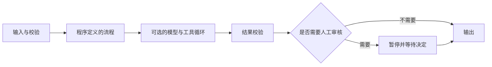
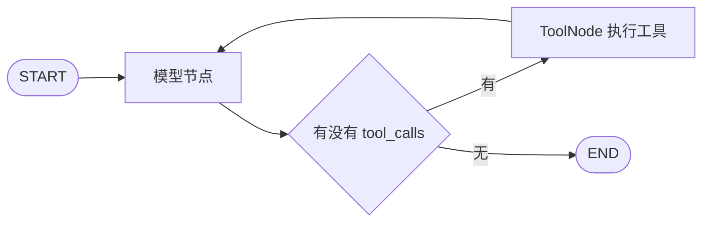
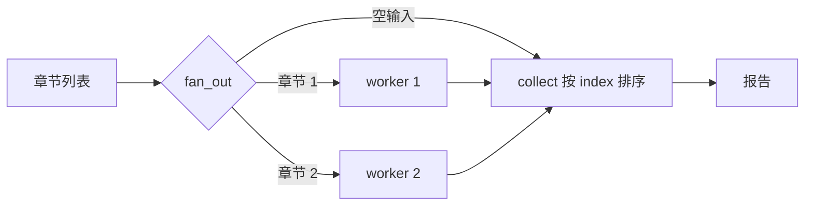
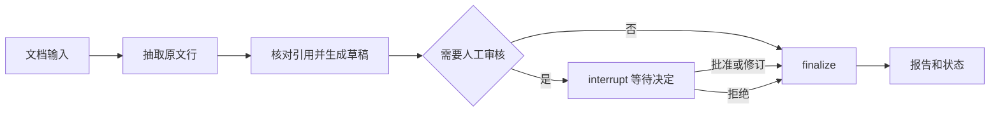

# LangGraph 学习指南：理解状态，做出可恢复的 Agent 工作流

修订日期：2026-10-19。适用：Python；本次验证组合为 Python 3.12.14、LangGraph 1.2.16、LangChain 1.4.6。

**LangGraph 没有过时，值得学。** 真正要更新的是旧教程里的 API 入口、状态与恢复语义，以及“跑通演示就等于能上生产”的预期。这份指南先让你看懂每一步执行，再接入模型，最后学习如何判断系统是否可靠。

目标是完成一个能保留证据、人工审核、暂停恢复的文档处理工作流，并能说明它为什么这么执行。主线实验不需要 API Key；真实模型是后续可选实验。

配套文件见同目录的 `examples/`、`tests/`。克隆本仓库后，在仓库根目录执行命令；离线压缩包也可在解压后的根目录执行。原文的逐条问题与官方依据见 [原文审阅与修改说明](原文审阅与修改说明.md)。

## 阅读导航

1. 技术位置与学习路线
2. 环境准备与最小状态图
3. Reducer、消息与运行上下文
4. 工具循环与真实 Agent
5. 持久化、人工介入与恢复
6. 并行、重试与流式
7. 文档项目、评测与生产边界

第一次学习按顺序做；遇到旧项目，先读第 15 节迁移速查。不要为了先背完术语而推迟运行第一个实验。

## 1. 先分清你在学哪一层

| 层次 | 解决的问题 | 什么时候用 |
| --- | --- | --- |
| 普通 Python + 模型 SDK | 调一次模型，处理一次响应 | 一次翻译、摘要、分类，流程简单且无需恢复 |
| LangChain `create_agent` | 模型选择工具、读取结果、继续执行 | 标准的“模型—工具”循环，希望快速做出 Agent |
| LangGraph `StateGraph` | 明确的状态、分支、并行、检查点和暂停恢复 | 需要精确控制流程、审批或长时间任务 |
| LangSmith 等观测／评测系统 | 查看运行轨迹，评估效果与成本 | 从开发调试到线上质量跟踪；不是使用核心库的前提 |

`create_agent` 构建在 LangGraph 之上；两者可以组合。你无需因为学习 LangGraph，就把每一个普通函数都画成节点。

多智能体、MCP、RAG 是后续按需求组合的能力。RAG 解决检索上下文；MCP 解决工具／上下文的协议接入；多智能体解决角色分工。它们不自动保证答案正确，也不必同时出现在第一个项目里。

### 工作流与 Agent

工作流的路径主要由程序定义：分类 → 提取 → 审核。Agent 的下一步主要由模型选择：是否调用工具、调用哪个工具、什么时候结束。真实系统经常将两者混合：外层流程控制权限、预算和审批，内层 Agent 处理开放问题。



## 2. 学习路线：每一步都要交出一个能解释的结果

先确认会用 Python 函数、字典、列表、异常和虚拟环境。`TypedDict` 用于描述字典字段；`Annotated` 用于给字段附加 reducer；`async/await` 等掌握同步主线后再学。遇到这些语法不熟，可以边做边查，不需要先学完全部类型系统。

下面每次学习约 45–90 分钟，按自己的速度推进。关键是完成标准，而不是天数。

| 次序 | 实验 | 完成标准 |
| --- | --- | --- |
| 1 | `minimal` | 画出 START→greet→END，解释为什么节点只返回一个字段 |
| 2 | `message_memory` | 预测两轮后的消息数量，解释换 thread_id 后发生什么 |
| 3 | `tool_loop` | 找到 AIMessage、tool_calls、ToolMessage 和最终回复 |
| 4 | `context_demo` | 分清业务状态、运行依赖、执行配置 |
| 5 | `approval start/approve/reject` | 关闭进程后继续审批，拒绝时没有发布回执 |
| 6 | `parallel` | 空输入与多章节都能结束，输出顺序明确 |
| 7 | `retries`、`streaming` | 解释重试总次数，区分进度和最终结果 |
| 8 | `document_workflow` | 触发自动、人工批准、人工拒绝三条路径 |
| 9 | 可选 `real_agent` | 用消息轨迹证明真实模型调用了工具，不能只看最后一句话 |
| 10 | 自己增加需求并评测 | 加一条新规则，说明它改善了什么，同时记录代价 |

每次都做一个小动作：**先写预测 → 执行 → 比较结果 → 故意制造一次失败 → 用自己的话解释原因。** 只看终端打印“成功”，很难发现自己对恢复或状态合并的误解。

## 3. 环境：先保证可以重复运行

学习包提供两个依赖文件：`requirements.in` 是四个直接依赖，`requirements.lock.txt` 是本次解析并验证过的完整版本及 SHA256 哈希。不要把个人机器的所有包都混进本项目依赖。

在学习包根目录执行；建议使用 Python 3.12。下面是 Bash 命令：

```bash
python3 -m venv .venv
source .venv/bin/activate
python -m pip install --require-hashes -r requirements.lock.txt
python -m unittest discover -s tests -v
python -m examples.minimal
```

Windows 可直接使用虚拟环境解释器，无须为了本教程调整 PowerShell 执行策略：

```powershell
py -3.12 -m venv .venv
.venv\Scripts\python.exe -m pip install --require-hashes -r requirements.lock.txt
.venv\Scripts\python.exe -m unittest discover -s tests -v
.venv\Scripts\python.exe -m examples.minimal
```

Windows 命令供使用方式参考；本次实际执行平台是 Linux，不将它描述成已验证的 Windows 环境。

查看版本使用包元数据，而不是假定模块都有 `__version__`：

```python
from importlib.metadata import version

print("langgraph", version("langgraph"))
print("langchain", version("langchain"))
```

本次学习包包含 35 项已通过的离线测试。下载依赖需要网络；安装完成后，除 `real_agent` 外的示例不请求模型服务。测试主动关闭外部 tracing。新版本可能改变接口，升级后重新验证，不要把学习时的可复现版本误当成未来永不升级的版本。

## 4. 第一个图：节点返回的是更新

运行 `python -m examples.minimal`。下面是该文件的完整内容：

```python
"""运行：python -m examples.minimal"""
from typing import TypedDict
from langgraph.graph import END, START, StateGraph


class State(TypedDict):
    name: str
    greeting: str


def greet(state: State) -> dict:
    name = state["name"].strip()
    if not name:
        raise ValueError("name 不能为空")
    return {"greeting": f"你好，{name}！"}


def build_graph():
    builder = StateGraph(State)
    builder.add_node("greet", greet)
    builder.add_edge(START, "greet")
    builder.add_edge("greet", END)
    return builder.compile()


if __name__ == "__main__":
    print(build_graph().invoke({"name": " 小明 "})["greeting"])
```

预期输出：`你好，小明！`。

`StateGraph(State)` 是构建器；`compile()` 生成可执行对象。`greet` 读取 `name`，只返回 `greeting`。没有 reducer 的普通字段使用覆盖语义；没有返回的字段保持原值。之后修改构建器，也不会追溯修改已经编译的对象。

`TypedDict` 是类型描述，不会因为你写了 `greeting: str`，就自动补一个空字符串或替你检查所有输入。示例里输入没有 greeting 也能运行，是因为节点随后生成它；如果没有 name，节点读它时会报错。

**练习：** 加一个 `normalize` 节点，在它里面 strip 姓名，再连接到 greet。先预测最终状态里的 name 是原输入还是处理后的输入。完成标准：你能区分“Python 局部变量被改了”和“状态字段被节点更新了”。

## 5. Reducer：先决定字段的含义，再决定怎么合并

```python
import operator
from typing import Annotated, TypedDict

class State(TypedDict):
    answer: str                         # 新答案替换旧答案
    attempts: int                       # 需要显式更新数值
    findings: Annotated[list[str], operator.add]  # 收集本任务多个步骤的发现
```

字段的合并规则是逐字段的。嵌套字典也不会默认递归合并：返回一份新的 `user` 通常会替换整个 user 字段。

| 字段含义 | 常见更新规则 | 容易犯的错 |
| --- | --- | --- |
| 最后一次答案 | 覆盖 | 误设成追加，越跑越长 |
| 本轮检索结果 | 通常覆盖 | 把旧查询结果无条件混到新查询 |
| 并行任务收集结果 | 显式 reducer，如列表拼接 | 多个并行任务写同一普通字段而报冲突 |
| 聊天消息 | `add_messages` | 返回全部历史，或者把截短列表误当删除命令 |

Reducer 应尽量纯净、可预测，并考虑重复值、合并顺序及重放。并行列表如需展示成原始顺序，应携带 index 并显式排序，不依赖任务完成时间。

### 理解 super-step

同一步中激活的节点可以并行执行，读取这一步可见的状态，再提交更新。下一步才看到合并后的结果。不要把 State 想象成多个线程随意原地修改的全局 dict。

两个同一步的节点都返回 `{"answer": ...}`，且 answer 没有 reducer 时，通常会得到 `InvalidUpdateError`。它不是简单的“谁慢谁覆盖”。学习包有一项专门验证这个预期错误的测试。

## 6. 消息：每条记录都有角色，工具还有关联 ID

`MessagesState` 已经为 messages 使用 `add_messages`。新 ID 的消息会追加；相同 ID 的消息会更新；`RemoveMessage` 用于明确删除。这不是按内容或语义自动去重。

```python
from langchain_core.messages import HumanMessage, RemoveMessage
from langgraph.graph import add_messages

messages = [HumanMessage(content="你好", id="u1")]
messages = add_messages(messages, [HumanMessage(content="修订后的问题", id="u1")])
assert len(messages) == 1
messages = add_messages(messages, [RemoveMessage(id="u1")])
assert messages == []
```

运行 `python -m examples.message_memory`，两轮后会有 4 条消息：两条用户消息与两条回显。这里是固定回显器，不具备语言理解能力；它验证的是消息是否被保留。

有 checkpointer 且继续同一 thread 时，每轮通常只提交**新增消息**。同时，把“写入状态的完整历史”和“这次发送给模型的上下文”分开：模型窗口有限，可能需要筛选或摘要，但不能破坏工具调用和工具结果的配对。

直接向 `add_messages` 返回最近几条旧消息，不保证删除其他旧消息。删除当前消息、裁剪模型上下文、清理数据库历史检查点，是三件不同的事。

## 7. 工具循环：先把协议看清，再让模型做决策

标准循环是：



工具通常包括三层：函数实际执行逻辑；参数 schema 与工具描述；模型输出的调用请求。模型的 tool_call 只是请求，真正的权限与参数边界应由执行层控制。

运行 `python -m examples.tool_loop`。这里故意使用固定脚本模拟模型，因此每次都请求计算 6×7；不要用它回答任意计算问题。

```python
"""运行：python -m examples.tool_loop。模型节点是固定脚本，不会理解任意问题。"""
from langchain_core.messages import AIMessage, ToolMessage
from langchain_core.tools import tool
from langgraph.graph import END, START, MessagesState, StateGraph
from langgraph.prebuilt import ToolNode, tools_condition


@tool
def multiply(a: int, b: int) -> int:
    """将两个绝对值不超过一百万的整数相乘。"""
    if abs(a) > 1_000_000 or abs(b) > 1_000_000:
        raise ValueError("参数超出教学示例允许范围")
    return a * b


def scripted_model(state: MessagesState) -> dict:
    last = state["messages"][-1]
    if isinstance(last, ToolMessage):
        return {"messages": [AIMessage(content=f"工具返回：{last.content}")]}
    return {"messages": [AIMessage(content="", tool_calls=[{
        "name": "multiply", "args": {"a": 6, "b": 7},
        "id": "call-demo-1", "type": "tool_call",
    }])]}


def build_graph():
    builder = StateGraph(MessagesState)
    builder.add_node("model", scripted_model)
    builder.add_node("tools", ToolNode([multiply]))
    builder.add_edge(START, "model")
    builder.add_conditional_edges("model", tools_condition)
    builder.add_edge("tools", "model")
    return builder.compile()


if __name__ == "__main__":
    result = build_graph().invoke(
        {"messages": [("human", "演示 6 × 7 的工具调用过程")]},
        config={"recursion_limit": 10},
    )
    for message in result["messages"]:
        print(message.type, repr(message.content), getattr(message, "tool_calls", ""))
```

你应看到：HumanMessage → 带 tool_calls 的 AIMessage → 内容为 42 的 ToolMessage → 普通 AIMessage。

关键细节：ToolMessage 的 `tool_call_id` 要对应请求的 id；`tools_condition` 默认寻找名为 `tools` 的节点；计算工具使用固定运算，不解释任意 Python 表达式。真实工具还可能并行执行，所以有顺序依赖的写操作不能随便放进可并行工具列表。

**练习：** 把乘数改成超出范围的数，先观察工具错误，再查看消息轨迹。不要把“ToolNode 返回了错误信息”和“整个业务成功完成”混为一谈；业务仍需决定重试、询问还是结束。

### 模型对象不能自动充当状态适配器

真实模型一般这样接入自定义图：

```python
from langgraph.graph import MessagesState

def make_model_node(model_with_tools):
    def call_model(state: MessagesState) -> dict:
        response = model_with_tools.invoke(state["messages"])
        return {"messages": [response]}
    return call_model
```

这是一个工厂函数，需传入已经初始化并绑定工具的模型。不能假定 `add_node("model", ChatOpenAI(...))` 会自动把状态 dict 改成消息列表，并自动包装输出。

## 8. 运行时有三种不同的信息

| 位置 | 应放什么 | 示例 |
| --- | --- | --- |
| State | 业务执行到哪里、产生了什么结果 | messages、draft、evidence、status |
| Runtime context | 本次运行注入的依赖或上下文 | 已认证用户标识、客户端、策略配置 |
| Runnable config | 图的执行配置 | thread_id、recursion_limit、max_concurrency |

运行 `python -m examples.context_demo`。代码通过 `StateGraph(..., context_schema=Context)` 声明上下文，节点用 `runtime: Runtime[Context]` 获取它，调用时传 `context=Context(...)`。

context 不会仅因被声明就自动作为业务状态保存，但如果你将其中内容写入状态、日志或回复，那些输出当然可能被保留。数据库连接和客户端不该塞进 checkpoint；密钥也不该成为会话消息。

生产里的 user_id 应来自认证后的服务端上下文，不能把调用者随便输入的 user_id 当成已经授权的身份。

## 9. 持久化：先回答“什么要活过进程重启”

| 概念 | 作用 | 不能由它推出的结论 |
| --- | --- | --- |
| Checkpointer | 保存一个 thread 的图状态、进度与恢复信息 | 不能保证外部通知只发送一次 |
| thread_id | 查找某个执行／会话的检查点 | 它不是用户认证，也不是访问令牌 |
| Store | 保存跨 thread 的应用数据，如已确认偏好 | 不代表模型会自动读取或记住全部内容 |
| 模型上下文 | 本次真正发送给模型的内容 | 与数据库里保存的全部历史不必相同 |

`InMemorySaver` 用于演示和测试，进程结束后数据丢失。`MemorySaver` 本次仍是其别名。SQLite 适合本地持久化实验；更复杂的并发和服务部署再考虑 Postgres 等后端，不能仅凭“换成数据库”就认定生产可靠。

开启 checkpointer 后，不同 thread_id 通常有独立的图状态。同一用户也可能有多个会话；跨会话数据应显式存储并按租户／用户授权读取，不要为全部用户共用一个 thread_id。

查看状态与历史可以帮助理解恢复；检查点应按执行步边界、任务写入和所用 durability 配置理解，不要把它简化成“每个节点都是一个已经永久安全保存的事务”。生产选择强持久化模式时，也要测延迟和崩溃行为。

## 10. 人工介入：暂停可以持续，恢复会重跑节点

需要 checkpointer、稳定的 thread_id、可序列化的中断内容，以及外部提交的 `Command(resume=...)`。

### 先做真正的跨进程实验

```bash
python -m examples.approval start --thread approval-001
python -m examples.approval inspect --thread approval-001
python -m examples.approval approve --thread approval-001

python -m examples.approval start --thread approval-002
python -m examples.approval reject --thread approval-002
```

这些命令每次都会启动一个新 Python 进程，数据保存在学习包的 `.local/approval.sqlite`。第一条应出现中断内容且没有发布回执；批准后才有“模拟发布成功”；拒绝则显示“已取消”。重新开始时换一个新 thread，程序会阻止覆盖已有会话。

完整实现见 [examples/approval.py](examples/approval.py)。它没有发布到任何外部系统，只生成模拟回执。下面是在内存中观察机制的独立用法：

```python
from examples.approval import build_graph
from langgraph.checkpoint.memory import InMemorySaver
from langgraph.types import Command

app = build_graph(InMemorySaver())
config = {"configurable": {"thread_id": "approval-local"}}
paused = app.invoke({"request_id": "r1", "draft": "待审批的草稿"}, config)
print(paused["__interrupt__"][0].value)
completed = app.invoke(Command(resume={"approved": True}), config)
print(completed["receipt"])
```

### 最容易误解的规则

恢复时，**所在节点从头再执行**。第一次走到 interrupt 会暂停；恢复后再次走到这个 interrupt 时，得到外部传入的值，再继续向后。它不是把 Python 调用栈原封不动冻结下来。

所以：

- interrupt 前的代码必须能够安全重复执行；先发通知再等审批，会导致重复通知或提前执行。
- 不要用裸 `except` 或捕获 BaseException 把中断吞掉；按明确错误类型处理。
- 同一节点里的多个 interrupt 按顺序匹配恢复值，不要在恢复期间改变其顺序或随意绕过某次调用。
- “批准”必须绑定已认证审批人和具体版本的请求；thread_id 或前端按钮本身不够。
- 把审批与执行动作拆成节点，仍不能消除“外部系统成功，但检查点尚未落盘就崩溃”的窗口。

真实的扣款、邮件或发布，应使用业务幂等键、唯一约束、事务 outbox 或目标系统提供的去重机制。**幂等指重复尝试不会增加额外业务副作用；它不等于模型每次输出一模一样。**

示例用 `Command(update=..., goto=...)` 同时更新状态和选择下一节点。不要又从同一节点加一条无条件出边，以为 Command 会自动取消它；静态边也可能继续调度。

**练习：** 先批准一次，再尝试重复批准，观察 CLI 拒绝；思考如果两个网络请求同时到来，该怎样在数据库和应用层实现互斥／去重。当前 CLI 的顺序检查不是完整的分布式并发控制方案。

## 11. 并行：分清任务输入、合并规则与展示顺序

运行 `python -m examples.parallel`。完整代码见 [examples/parallel.py](examples/parallel.py)。

路由函数返回多个 `Send("summarize", {"index": i, "chapter": text})`。这些 worker 不必使用与主图完全一样的输入 schema；各自只拿到需要的数据，再把结果写回主图声明的通道。

results 使用列表 reducer 收集结果；collect 显式按 index 排序。空章节列表也有通向 collect 的路径，不能假定永远至少有一个任务。

这里的“摘要”只是文本切片，用来验证执行与收集；换成模型调用后，仍要独立验证摘要质量。



固定的并行节点可以用 `add_edge(["a", "b"], "join")` 表达等待两个前驱完成；更复杂、不等长的并行支路要仔细设计汇合与触发条件。不能把任意多条边都当成自动正确的 join。

`max_concurrency` 可以限制图运行的并发度，但不替代供应商的速率限制。跨多个进程共享 API 配额时，还需统一的限流策略。

**练习：** 输入 0、1、3 个章节；再让某个 worker 抛异常，观察是否有“看起来成功”的不完整报告。明确你的产品要全有或全无，还是允许部分结果。

## 12. 错误、重试、超时与预算各管一件事

运行 `python -m examples.retries`，预期模拟服务总共调用 3 次，前两次超时，第三次成功。

正确入口和关键参数是：

```python
from langgraph.types import RetryPolicy

policy = RetryPolicy(
    max_attempts=3,        # 包括首次，总共最多 3 次
    retry_on=TimeoutError,
    initial_interval=0.5,
    backoff_factor=2.0,
    jitter=True,
)
# builder.add_node("request", request_node, retry_policy=policy)
```

这只是策略配置片段；完整可运行示例见 [examples/retries.py](examples/retries.py)。实际模型 SDK 抛出的超时类型可能不是内置 TimeoutError，应按该集成的错误类型配置。

| 控制 | 应解决的问题 | 不应承担的问题 |
| --- | --- | --- |
| RetryPolicy | 暂时性失败后重试 | 修复错误参数、401/403、程序 bug |
| 网络／模型 timeout | 一次请求不能永久等待 | 限制全部任务的总费用 |
| recursion_limit | 防止图持续运行过多 super-step | 精确计费、供应商限流或工具次数预算 |
| max_concurrency | 同次执行的并发度 | 跨进程共享配额 |
| 业务预算 | 工具次数、总时间、token 与费用上限 | 被一个任意的图步数完全替代 |

一次工具循环不能普遍换算为“固定 3 步”。并行节点可能属于同一步；单个节点内部也可能发起多个请求。把所有超限错误都解释成“再调大 recursion_limit”会掩盖真正的循环问题。

模型 SDK 自身也可能重试，叠加节点重试后尝试次数会增加。明确哪层负责重试，并验证耗尽后向上报告错误。捕获所有异常再返回一份正常答案，会让监控误以为任务成功。

**练习：** 对照测试，把 failures 改为 9：它应在总共 3 次尝试后失败。再将错误换成 ValueError：此示例不应重试它。

## 13. 流式：执行进度、模型内容和最终输出分开处理

当前 stream-mode API 常用的模式如下：

| stream_mode | 你收到什么 |
| --- | --- |
| `updates` | 节点提交的状态更新 |
| `values` | 执行步之后的状态快照 |
| `messages` | 模型消息片段与 metadata，可能包含工具调用参数片段 |
| `custom` | 节点通过 writer 发出的自定义进度 |
| `checkpoints` / `tasks` / `debug` | 用于深入诊断的检查点和任务事件等，具体前提看对应文档 |

为了避免旧格式在单模式、多模式、子图之间改变形状，本教程主线显式用 `version="v2"`：每条是包含 type、ns、data 的 StreamPart 字典。

运行 `python -m examples.streaming`，它会输出 custom 进度和 updates 结果。完整实现见 [examples/streaming.py](examples/streaming.py)。

```python
from examples.streaming import build_graph

for part in build_graph().stream(
    {"value": 0}, stream_mode=["updates", "custom"], version="v2",
):
    print(part["type"], part["data"])
```

做真实模型聊天 UI 时，`messages` 的 data 通常是消息片段与 metadata 的组合。按节点和内容类型过滤；chunk 不保证是一个字、一个 token，或总是普通字符串。工具参数还没收齐时，不能把不完整片段直接拿去执行。

### 关于 LangGraph 1.2 的新事件流

官方最新文档推荐面向应用的 typed projection 事件流。它可把 messages、values、subgraphs 等消费方式分开：

```python
from examples.minimal import build_graph

run = build_graph().stream_events({"name": "小明"}, version="v3")
for snapshot in run.values:
    print(snapshot)
print(run.output)
```

这段已在本次版本运行验证，但会出现实验性警告，源码也明确提示 API 可能变化。因此把它作为了解新能力的扩展，不要求初学者的所有代码立即迁移。依赖它时固定版本并做回归测试。

注意三个“版本”不是一回事：`stream(..., version="v2")` 的输出包装、旧 Runnable `astream_events(..., version="v2")` 的回调事件协议，以及新 `stream_events(..., version="v3")` 的投影 API。不要只看字符串 v2/v3 就认为它们可以互换。

## 14. 综合项目：可追溯的文档工作流

运行 `python -m examples.document_workflow`。代码见 [examples/document_workflow.py](examples/document_workflow.py)。

这个版本先做离线抽取：从原文非空行产生带行号的引用，检查引用是否真在对应原文行中，生成草稿，根据规则选择自动或人工流程。它是工作流实验，不声称会理解任意文档。



自动路径输入两行或更多内容；人工路径使用短文或 force_review；拒绝路径最终 status 为 rejected、report 为空。三条路径均有测试。示例中的“至少两条证据”只用于制造可观察分支，不是语义质量标准。

### 如何把这个骨架逐步改成真实 AI 应用

1. 保留原文版本、行号／段落 ID 与内容哈希。大文件保存在对象存储，状态只放引用和必要摘要；本示例的小文本直接放 state 是为了便于实验。
2. 将 extract 换成结构化模型输出：每条有要点、来源位置、原文引用。使用 Pydantic/schema 校验结构，禁止把模型返回字符串直接当可信对象。
3. 仍由代码核对引用是否存在。它只能证明“这段引文出现过”，不能证明它支持结论；语义支持与遗漏需要额外评测或人工检查。
4. 把任务要求、原文与可调用工具分开，明确原文是不可信数据。文档里的“忽略上文”“调用某工具”等句子不能获得系统指令的地位。
5. 从人工标注样本确定审核规则。重要场景不要用模型自报的 0.9 分当可靠概率；对缺证据、冲突、高风险或失败样本保留审核路径。
6. 先测小批固定样本，记录正确率、引用有效率、遗漏、工具使用、延迟和费用，再决定是否加检索或更多 Agent。

### 你应该写出的验收案例

| 输入／事件 | 应观察的结果 |
| --- | --- |
| 普通短文 | 输出可追溯引用，没有编造事实 |
| 空白或超长输入 | 明确拒绝或按已定义规则处理，不伪造成功 |
| 模型给出不存在的引文 | 校验失败或转人工，不直接进入自动通过 |
| 人工修订 | 最终保存被批准的修订稿与对应版本 |
| 人工拒绝 | 不执行后续发布动作 |
| 审核前进程退出 | 重启后仍能读取同一待审核请求 |
| 同请求重复提交 | 根据明确策略拒绝、复用结果或去重，不重复产生副作用 |
| 文档含恶意指令 | 仍按文档数据处理，不扩大工具权限 |

当前学习包自动验证的是其中可离线证明的执行机制和引用存在性；语义质量、真实模型抗注入、真实发布幂等需要在接入真实能力后另测。

## 15. 接入真实模型，以及阅读旧教程的迁移速查

标准 Agent 的新代码使用 `langchain.agents.create_agent`。先在安全的环境变量设置里配置 `OPENAI_API_KEY`，再把 `LLM_MODEL` 设置为账号目前可用、支持工具调用的模型 ID。密钥不写入文档、代码或聊天记录；不用把历史文章里的某个模型名当成永久可用的承诺。

在学习包根目录运行：

```bash
python -m examples.real_agent
```

它调用真实模型，会产生供应商费用；本次交付没有执行这一步。完整代码在 [examples/real_agent.py](examples/real_agent.py)。它使用 `create_agent(model=..., tools=[multiply], system_prompt=..., checkpointer=...)`，不是旧的 create_react_agent。

验证时先直接执行工具，确认 `multiply.invoke({"a": 6, "b": 7}) == 42`；再运行 Agent，检查是否真的产生 tool_calls 和对应 ToolMessage。最后答案说“42”，并不能独立证明模型使用了工具。

温度设为 0 也不等于绝对可复现；服务端版本、模型行为和工具选择仍可能变化。保留框架执行的确定性测试，再为模型效果增加重复运行的评测。

| 旧资料写法／说法 | 当前应优先理解的方式 |
| --- | --- |
| `from langgraph.prebuilt import create_react_agent` | 新代码用 `from langchain.agents import create_agent` |
| `prompt=` | create_agent 的系统提示用 `system_prompt=`，其他旧参数需查迁移映射 |
| `langgraph.__version__` | `importlib.metadata.version("langgraph")` |
| `from langgraph.pregel import RetryPolicy` | `from langgraph.types import RetryPolicy` |
| `add_node(..., retry=...)` | `retry_policy=...` |
| `StateGraph(..., input=..., output=...)` | `input_schema=...`、`output_schema=...` |
| `MemorySaver` | 本次仍兼容；新示例用名字更清楚的 InMemorySaver |
| `create_supervisor` 默认首选 | 先看官方当前建议；多数新应用可用 tools 组合 supervisor pattern |
| SDK `graph_id=` | 当前 Runs API 参数叫 `assistant_id=`；图名可作为其值，创建后台 run 与等待最终结果要区分 |

MCP 后续再学。本次核验的 LangChain 1.4 已提供 beta 的 `langchain.mcp` / MCPAdapter，旧 `langchain-mcp-adapters` 有迁移路径。工具集成也在变化，不能拿一个不带版本的安装命令同时代表所有年代的用法。

## 16. 子图和多智能体：等你能证明收益时再增加

当“检索—排序—摘要”已经是一个职责明确、可测试的单元，可以封装成子图。父子图有共享状态键时可以直接组合；schema 不同就写输入输出适配函数。不同 schema 不等于安全隔离，下划线字段也不等于秘密。

增加第二个 Agent 前，先记录单 Agent 基线。只有当专业工具、上下文隔离、独立职责或可验证的效果提升值得额外成本时再拆分。一个角色一句提示词，并不自动构成有价值的协作系统。

需要明确：谁决定下一步、传递哪些消息、如何保留来源、何时停止、失败由谁接管、总调用预算是多少。Supervisor、handoff、固定流程是不同选择，不是层级越深越高级。

## 17. 从本地可运行到生产，需要补齐什么

`compile()` 只生成进程内的可执行图，不会自动创建 HTTP 服务。开发服务、托管部署、自建服务也不是同一个运行契约。当前官方文档使用 Agent Server、LangSmith Deployment 等术语；组件和许可要求应以准备部署时的文档为准。

学习包没有启动 Agent Server，没有验证 Postgres、真实多用户鉴权或线上负载。下面是进入生产前的工作清单，不是“本地测试通过即全部满足”的声明。

| 方面 | 必须能够回答的问题 |
| --- | --- |
| 数据与恢复 | 哪些状态持久化？备份怎样恢复？运行到一半崩溃会重复什么？ |
| 访问控制 | 谁能读取和恢复这个 thread？租户隔离在哪里执行？ |
| 外部副作用 | 重试、重复点击、网络超时后重复提交，是否多发一次／多扣一次？ |
| 并发 | 同一个 thread 的两个请求如何排队、拒绝或协调？ |
| 时间与费用 | 请求超时、总任务超时、工具上限、token 费用和限流在哪里控制？ |
| 内容与权限 | 工具参数由谁校验？文档里的恶意指令能否触发超范围动作？ |
| 观测 | 怎样知道任务失败、被拒绝或预算耗尽？日志是否泄露原文或密钥？ |
| 质量 | 有没有固定样本、重复评测和回归阈值？换模型后效果如何？ |
| 保留与删除 | messages、checkpoint、Store 和 trace 各留多久？用户请求删除时覆盖哪些系统？ |
| 发布 | 依赖与配置怎么固定？升级后旧检查点是否兼容？如何回滚？ |

使用 PostgresSaver／AsyncPostgresSaver 时，要遵循官方的 Psycopg 3、初始化、连接池和生命周期说明。使用 Agent Server 时，持久化通常由服务端管理，不要照搬进程内 compile(checkpointer=...) 的模式自行叠加。先选运行方式，再配置相应后端。

流式界面出现了文字也不代表最终成功；需要独立处理完成、错误、中断和取消。启用 tracing 前确认上报内容，团队共享的 trace 不应成为泄露原始资料的另一条路径。

## 18. 最后的自测：不用背 API，先能讲清这些问题

1. 为什么节点通常只返回更新字段，而不是返回整个 state？
2. 同一步两个节点写同一字段时，什么情况下能合并，什么情况下会报错？
3. 为什么 `add_messages` 不是语义去重，也不是“截短列表就清除历史”？
4. 为什么同一个 thread_id 能恢复状态，却不能证明调用者有权限？
5. `interrupt()` 恢复后哪段代码会再次运行？
6. 为什么把发布拆到下一个节点，仍然需要业务幂等？
7. 为什么 recursion_limit 不能直接当作模型费用上限？
8. 模型输出有合法 JSON，为什么还可能有伪造引用或错误结论？
9. 一个 Agent 最后回答正确，为什么还要看工具轨迹？
10. 你的第二个 Agent 相比单 Agent 基线，改善了什么？

建议先完成第 4、7、10、14 节的实验，再回头回答。能从状态、消息和检查点解释行为，比记住几十个类名更接近真正掌握。

## 官方材料与验证边界

- [LangGraph 官方概览](https://docs.langchain.com/oss/python/langgraph/overview)
- [Graph API](https://docs.langchain.com/oss/python/langgraph/graph-api)
- [持久化](https://docs.langchain.com/oss/python/langgraph/persistence)
- [人工介入](https://docs.langchain.com/oss/python/langgraph/interrupts)
- [流式](https://docs.langchain.com/oss/python/langgraph/streaming) 与 [新事件流](https://docs.langchain.com/oss/python/langgraph/event-streaming)
- [LangChain Agents](https://docs.langchain.com/oss/python/langchain/agents)
- [官方文档源码仓库](https://github.com/langchain-ai/docs)

版本、迁移和代码问题的逐条依据见 [原文审阅与修改说明](原文审阅与修改说明.md)，实际命令和已测／未测项目见 [验证记录](验证记录.md)。官方资料会更新；涉及实验性 API、部署和模型可用性时，要按实际安装版本重新核对。
